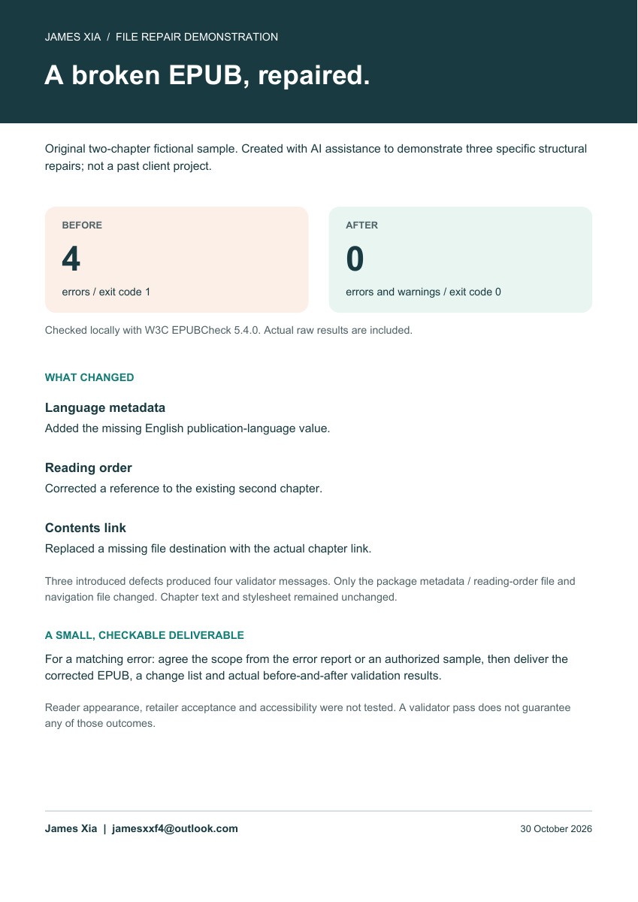
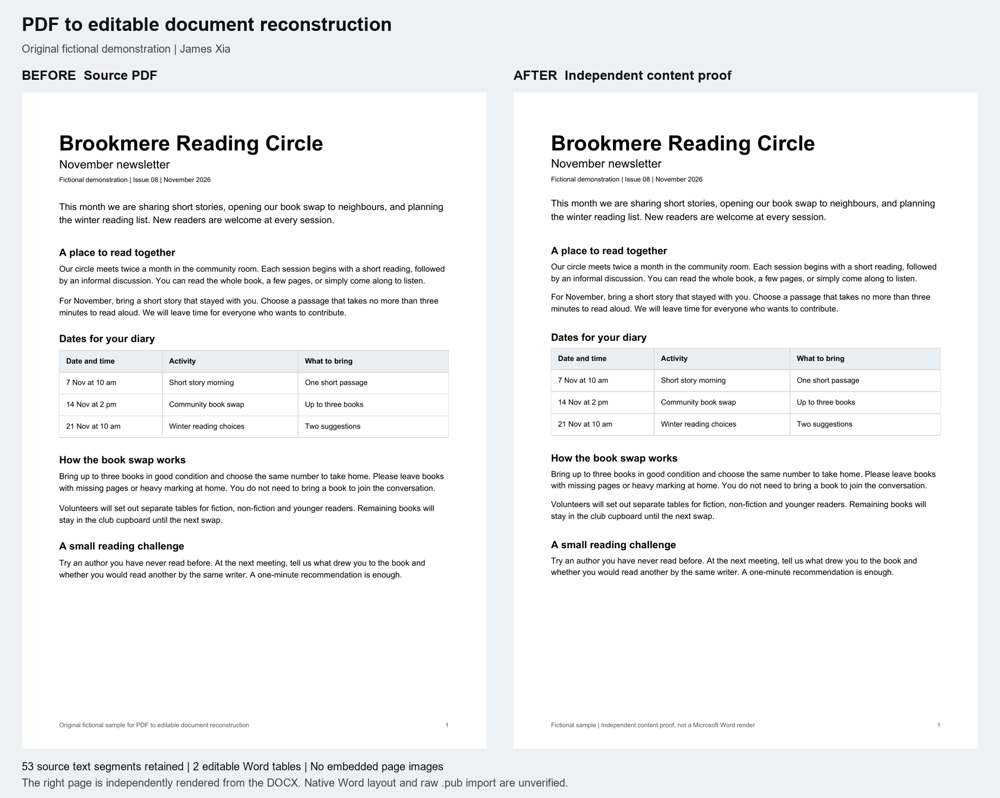

# Small file problems, checkable results

Original demonstrations by **James Xia**. These are fictional samples made with AI-assisted tools, not past client projects or customer endorsements.

## EPUB structural repair

An original two-chapter EPUB had three deliberately introduced defects: missing language metadata, a broken reading-order reference and an invalid contents link. Actual W3C EPUBCheck 5.4.0 results changed from **4 errors to 0 errors and 0 warnings**. Chapter text was preserved.

[One-page demonstration](EPUB%20Repair%20-%20Demonstration.pdf) · [Before EPUB](epub-before.epub) · [After EPUB](epub-after.epub) · [Measured results](epub-check-results.json) · [Before log](epub-before-check.log) · [After log](epub-after-check.log)

This checks specific structural faults. Reader appearance, retailer acceptance, accessibility and complex client manuscripts were not tested. A validator pass is not a guarantee of those outcomes.

## PDF to editable document

A fictional two-page club newsletter was reconstructed as normal Word paragraphs and two editable tables. All 53 source text segments were retained; there are no embedded page images in the Word file.

[Original PDF](Newsletter%20-%20Source.pdf) · [Editable Word file](Newsletter%20-%20Editable.docx) · [Independent content proof](Newsletter%20-%20Independent%20Content%20Proof.pdf)

The independent PDF proof reads the actual Word file's text, styles and tables, but is **not a Microsoft Word export or proof of identical Word pagination**. Native Word layout has not yet been visually verified. This example does not test raw Publisher .pub import, scanned handwriting, damaged files or complex artwork.

## Family recipe keepsake

[View the six-page fictional recipe notebook](Family%20Recipe%20Book%20-%20Demonstration.pdf)

Three invented recipe notes become searchable, consistently arranged pages. Missing quantities and uncertain servings remain clearly marked for family confirmation. The sample includes an input excerpt, contents and an editorial questions list. It is a layout demonstration, not a kitchen-tested cookbook. No real family archive was used.

## Discuss a small task

For an EPUB fault, start with the error message. For a document or recipe project, start with a description and, if appropriate, a redacted page you have permission to share. Scope, output format, price and timing are agreed after checking the materials.

Contact **jamesxxf4@outlook.com**. Please do not put private manuscripts, family archives or other confidential files in public GitHub issues.

Prepared 30 October 2026. The samples and checks above are the evidence for these demonstrations; no publisher approval, certification or prior customer work is claimed.
